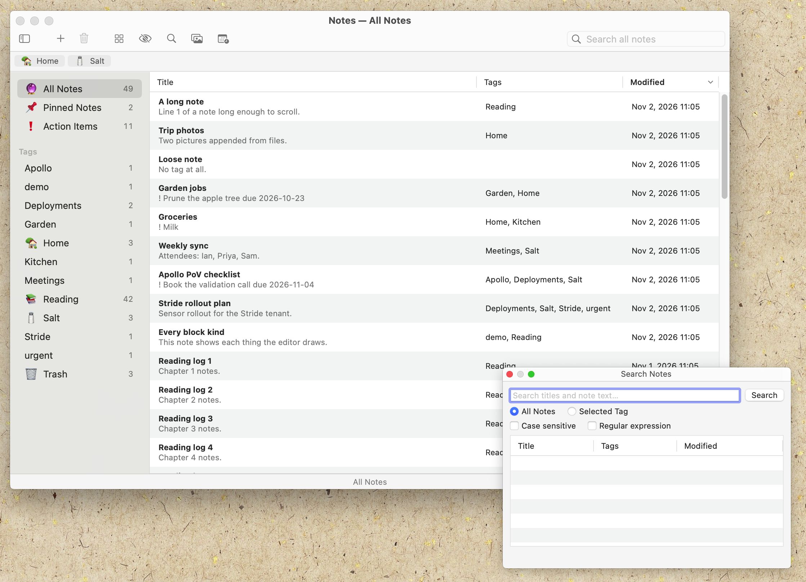

# Notes

<!-- Screenshot: save a capture of the library window as images/screenshot.png
     and replace this comment with:
      -->

Notes is a note-taking app that replaces Notes on macOS — a native AppKit
app with its own block document model, rich text with images, tables and
code blocks, and tags shared with the Tasks app. An `!` line in a note is
a real task in Tasks, with its due date and completion kept in step both
ways. There are no folders: tags organise everything, and the same tag set
serves both apps. It is an AppKit rewrite of a GTK4 app, still
experimental, and keeps that app's document model and database.

## Quickstart

**Prerequisites**

- macOS 14 (Sonoma) or later
- Xcode Command Line Tools: `xcode-select --install`
- MacPorts with `glib2`, `sqlite3` and `pkgconf`:

  ```sh
  sudo port install glib2 sqlite3 pkgconf
  ```

**Clone and build.** Notes compiles in the `shared_data` and `shared_ui`
modules, so check all three repositories out beside each other — the
build looks for `../shared_data` and `../shared_ui`, or the paths in
`SHARED_DATA_DIR` and `SHARED_UI_DIR`:

```sh
git clone https://github.com/IANatCAMBIO/Notes.git notes
git clone https://github.com/IANatCAMBIO/SharedData.git shared_data
git clone https://github.com/IANatCAMBIO/SharedUI.git shared_ui
cd notes
export PATH=/opt/local/bin:$PATH   # MacPorts pkg-config
make install
```

`make install` builds the bundle and copies it to `~/Applications/Notes.app`
(per-user; no `sudo`). A running copy is asked to quit first — which saves
every open note — and reopened afterwards. Settings and notes live outside
the bundle, so reinstalling never touches them.

| Command | What it does |
|---|---|
| `make` | build `Notes.app` in the repo root |
| `make seed` | create a test database in `dev/data` |
| `make run` | build, then run against `dev/data` — never your real notes |
| `make install` | build, then install to `~/Applications` |
| `make test` | release checks (build, unit, feature, UI) |
| `make clean` | remove `build/` and the bundle |

To try it without touching real data, `make seed && make run`.

The sources compile against macOS 14, but the binary is linked for the
macOS version your MacPorts GLib was built for, so that is the oldest
system it really runs on. See [BUILD.md](BUILD.md) for the toolchain,
dependencies, test targets and the platform notes.

## First run

Launch from `~/Applications`, or `make seed && make run` for the sandbox.

**The database.** With no database where one is expected, Notes asks
whether to create a new one there or open an existing shared database
file (which then becomes the default for both apps). It never creates one
silently, and it never falls back to another location if the database
cannot be opened. The default is
`~/Library/Application Support/camb.io/shared_data.db`, shared with Tasks;
the file must be on a local disk and outside iCloud Drive, Dropbox or any
other synced folder.

**Calendar access** is asked for once, the first time you turn on
Settings → Calendar. It is off until you do, and the day planner is the
only thing that uses it.

**AI features** are off until you turn them on in Settings → AI Features.
The command defaults to `claude -p` — the local Claude Code, read from
stdin, written to stdout — and the usual install directories are searched,
so no full path is needed. Name any other agent in *Meeting command* to
use it instead.

**It replaces a GTK copy.** This is a separate application from the GTK
Notes, with its own bundle identifier (`com.cambio.notes`), its own
settings folder and the database it shares with Tasks; it never reads or
writes the GTK app's database or settings. But both bundles are called
`Notes.app`, so `make install` replaces a GTK copy in `~/Applications`.

## Uninstalling

1. Quit Notes and delete `~/Applications/Notes.app`.
2. Your data is outside the bundle and survives, so Tasks goes on using
   it. To remove it too:

   ```sh
   rm -rf ~/Library/Application\ Support/Notes        # Notes' settings and lock
   rm -rf ~/Library/Application\ Support/camb.io      # the shared database and backups
   ```

   Delete `camb.io` only if you are removing Tasks as well — the tasks are
   in that same file.

## Features

Compared with Apple Notes:

- **Action items that are real tasks** — write `! Call the vet due
  2026-12-01` and it appears in Tasks tagged ❗ Action Items. Strike it
  through here and it completes there; complete it there and the line is
  struck through here, even in notes that are not open
- **Tags instead of folders** — a note's tags are the `#tags` in its text,
  living on a tag line above the title. Type `#` anywhere to pick from the
  known tags, and the tag moves itself up to that line. The same tag set
  serves Tasks, emoji and all
- **One database with Tasks**, open in both apps at once (SQLite WAL), so
  edits flow both ways within a second and neither app overwrites a field
  the other changed
- **A day planner inside the note library** (⇧⌘D) — your macOS Calendar's
  meetings beside your notes. Double-click a meeting and Notes makes a
  note titled after it, with the attendees as a bulleted list, ready to
  write. Double-click it again and you get that same note back
- **Summarize the last meeting** — the clock in the editor's toolbar finds
  the most recent earlier note with the same title, sends it to a local AI
  command and shows the answer in a panel. Your choice of agent; nothing
  leaves the machine unless the agent sends it
- **An AI summary of a whole tag or view** in the library, from the same
  local command
- **Rich text that is a real document model** — images, tables, code
  blocks and task lists, with its own layout and rendering rather than a
  text view with attributes bolted on
- **A media browser** across every note's images and attachments, and
  search across all notes
- **Hourly verified backups**, on by default: `VACUUM INTO` copies kept 48
  deep, with the policy in the database so Tasks follows it too
- **Export writes one file per note**, Markdown or HTML, each starting
  with its tags

Everything in detail — the tag model, the Tasks sync, the day planner, the
AI settings and where the data lives — is in
[USER_GUIDE.md](USER_GUIDE.md).

## License

BSD 3-Clause.
